<!-- header:start -->
<div align="center">



<a href="#-quick-start"></a>

<a href="LICENSE"></a>

<a href="https://github.com/ajendras/webmancer/stargazers"></a>
<a href="https://github.com/ajendras/webmancer/actions/workflows/ci.yml"></a>

<a href="CONTRIBUTING.md"></a>

**Turns plain-English browser tasks into ready-to-run Playwright scripts using local LLMs**

[✨ Features](#-features) • [⚡ Quick start](#-quick-start) • [🧰 Usage](#-usage) • [🧩 Architecture](#-architecture) • [📍 Roadmap](#-roadmap) • [🤝 Contributing](#-contributing)

</div>
<!-- header:end -->

## ✨ Why Webmancer?

Repetitive web tasks waste hours for developers, researchers and analysts. Existing automation either demands deep coding skills or routes data through opaque cloud LLMs. Webmancer fills the gap with a beautiful local-first web UI that converts natural language into clean, commented Playwright scripts while keeping every prompt and result on your machine.

- **Fully local** — every prompt, refinement and generated script stays on-device via Ollama; no telemetry, no cloud
- **Production-grade output** — `generateScript()` produces commented TypeScript using `getByRole`, `getByTestId`, `getByLabel` and robust best practices
- **Conversational refinement** — `refineScript()` lets you iterate with follow-up feedback in the chat UI
- **Instant visual feedback** — animated `Simulation` stepper previews every `navigate`, `click`, `fill` and `download` before you run it
- **Reusable gallery** — `Gallery` component with Zustand + localStorage, full-text search, tags and one-click load

## 🎬 Demo

<p align="center"></p>

## 🚀 Features

<table>
<tr>
<td>
🌐 <b>Natural Language</b><br>
Describe complex multi-page flows in everyday English
</td>
<td>
📄 <b>Playwright Output</b><br>
Generates clean, best-practice TypeScript scripts with comments
</td>
<td>
🔄 <b>Chat Refinement</b><br>
Iterate scripts through follow-up prompts in a conversational UI
</td>
</tr>
<tr>
<td>
🎥 <b>Visual Simulator</b><br>
Animated step-by-step preview of every click, type and navigation
</td>
<td>
🗄️ <b>Automation Gallery</b><br>
Save, tag and reuse scripts with full-text search (Zustand + localStorage)
</td>
<td>
📤 <b>One-click Export</b><br>
Copy script, download as .spec.ts or shareable recipe
</td>
</tr>
<tr>
<td>
🎯 <b>Robust Selectors</b><br>
AI prefers role, test-id, aria and text over brittle XPaths
</td>
<td>
📍 <b>Page Context</b><br>
Feed current URL or DOM snapshot for precise element targeting
</td>
<td>
🧠 <b>Local LLM</b><br>
Works with llama3.1 and any Ollama model — zero data leaves your machine
</td>
</tr>
</table>

## 📦 Installation

**Requirements**
- Node.js 20+
- Ollama running with a capable model (`ollama serve && ollama pull llama3.1`)

```bash
npx create-webmancer@latest my-project
cd my-project
npm install
npm run dev
```

Open http://localhost:3000. The gallery seeds with two demo recipes on first visit.

To run the test suite:

```bash
npm test
```

## ⚡ Quick start

```ts
import { generateScript } from '@/lib/ollama';

const recipe = await generateScript(
  'Log into the demo site, navigate to the reports page, and export the latest CSV'
);

console.log('Title:', recipe.title);
console.log('Steps:', recipe.steps);
console.log(recipe.code); // ready-to-run Playwright test
```

The returned `ScriptRecipe` can be passed directly to `<Simulation steps={recipe.steps} />` or `<ScriptPanel code={recipe.code} />`.

## 🧰 Usage

### Generate a new script with page context

```ts
import { generateScript } from '@/lib/ollama';

const result = await generateScript(
  'Fill the search box with "TypeScript" and press Enter',
  'Current page: https://example.com/search'
);
```

### Refine an existing script

```ts
import { refineScript } from '@/lib/ollama';

const improved = await refineScript(
  existingScriptCode,
  'Add an explicit wait for the results table and an assertion that at least 5 rows are visible'
);
```

### Call the API route directly (used by `PromptInput.tsx`)

```ts
const res = await fetch('/api/generate', {
  method: 'POST',
  headers: { 'Content-Type': 'application/json' },
  body: JSON.stringify({
    prompt: 'Scrape the first three product cards',
    context: 'Current page: https://example.com/products',
  }),
});

const { title, code, steps, explanation } = await res.json();
```

<details><summary>Advanced: low-level chat and status checks</summary>

```ts
import { chatWithOllama, getOllamaStatus } from '@/lib/ollama';

const status = await getOllamaStatus();
console.log('Ollama ready:', status.available);

const raw = await chatWithOllama('Explain why you chose getByRole over locator');
```

</details>

<details><summary>Using the Gallery store directly</summary>

```ts
import { useGalleryStore } from '@/components/Gallery';

const { recipes, addRecipe, deleteRecipe } = useGalleryStore();
addRecipe({ id: 'new-1', title: 'My automation', code: '...', steps: [], tags: ['demo'], createdAt: new Date() });
```

</details>

## 🔧 Configuration

<table>
<tr><th>Option</th><th>Default</th><th>Description</th></tr>
<tr><td><code>model</code></td><td><code>llama3.1</code></td><td>Ollama model name passed to <code>ollama.chat()</code></td></tr>
<tr><td><code>temperature</code></td><td><code>0.15</code></td><td>Generation temperature (0.25 for <code>refineScript</code>)</td></tr>
<tr><td><code>numCtx</code></td><td><code>16384</code></td><td>Context window size for the LLM</td></tr>
<tr><td><code>isRefinement</code></td><td><code>false</code></td><td>Flag sent to <code>/api/generate</code> to choose <code>refineScript</code> vs <code>generateScript</code></td></tr>
</table>

All options are accepted by `OllamaGenerationOptions` and forwarded from `src/lib/ollama.ts`.

## 🧩 Architecture

```mermaid
graph TD
    UI[page.tsx + PromptInput.tsx] -->|POST| API[/api/generate/route.ts]
    API -->|prompt, context or script+feedback| OllamaLib[src/lib/ollama.ts]
    OllamaLib -->|system + few-shot| Prompts[src/lib/prompts.ts]
    OllamaLib -->|ollama.chat({ format: 'json' })| LocalOllama[Ollama llama3.1]
    LocalOllama --> OllamaLib
    OllamaLib -->|validateGenerationResponse| API
    API -->|GenerationResponse| UI
    UI --> Simulation[Simulation.tsx<br/>animated stepper]
    UI --> ScriptPanel[ScriptPanel.tsx<br/>syntax-highlighted viewer]
    UI --> Gallery[Gallery.tsx + Zustand store<br/>localStorage persistence]
    Gallery -.->|addRecipe / deleteRecipe| UI
```

The data flow is deliberately simple: natural-language prompt → structured JSON from a local LLM → validated `ScriptRecipe` rendered by glassmorphic React components. All heavy lifting lives in `src/lib/ollama.ts` and `src/lib/prompts.ts`.

## 📁 Project structure

```text
.
├── src/
│   ├── app/
│   │   ├── api/generate/route.ts      # Next.js route handler calling generateScript/refineScript
│   │   ├── globals.css                # Glassmorphism, neon accents, mesh gradient, spring keyframes
│   │   ├── page.tsx                   # Main layout with chat, simulation and script sidebar
│   │   └── layout.tsx
│   ├── components/
│   │   ├── PromptInput.tsx            # Glass textarea + send button, handles generate/refine
│   │   ├── Simulation.tsx             # Animated vertical stepper with Lucide icons
│   │   ├── ScriptPanel.tsx            # Syntax-highlighted code viewer + Copy/Download
│   │   └── Gallery.tsx                # Zustand + persist store, search, tags, demo seeding
│   ├── lib/
│   │   ├── ollama.ts                  # generateScript, refineScript, chatWithOllama, getOllamaStatus
│   │   └── prompts.ts                 # BASE_SYSTEM_PROMPT, JSON schema, few-shot examples
│   └── types/
│       └── index.ts                   # ScriptRecipe, SimulationStep, ChatMessage, GenerationResponse
├── next.config.mjs                    # transpilePackages for ollama + shadcn
├── tailwind.config.ts                 # glass utilities, neon colors (#c026d3, #22d3ee)
├── tests/
│   └── generator.test.ts              # Vitest tests for prompts, mocked Ollama, schema validation
├── package.json                       # scripts: dev, build, test (vitest), deps: ollama, framer-motion, zustand
└── README.md
```

## 🧪 Testing

```bash
npm test
# or
npm run test:watch
```

The Vitest suite (`tests/generator.test.ts`) covers prompt template rendering, mocked Ollama JSON responses, `validateGenerationResponse`, selector quality checks, and round-trip generation/refinement flows.

## 📍 Roadmap

<!-- roadmap:start -->
- [x] **v0.1.0** — first release: Natural Language, Page Context, Playwright Output, Chat Refinement
- [ ] Add voice input via Web Speech API in PromptInput
- [ ] Support Puppeteer and Selenium script targets
- [ ] Implement local vector store for few-shot examples
- [ ] Companion Chrome extension to capture live page state
- [ ] Add conditional logic (if/else) in generated scripts
- [ ] Export automations as reusable npm packages
- [ ] Dark/light theme toggle with glass variants
- [ ] Integrated terminal tab to run scripts directly
- [ ] Shareable public gallery of community recipes
- [ ] Support for file uploads (PDFs, images) in prompts
- [ ] Add test assertion generation for Playwright
- [ ] Offline fallback using Transformers.js

> 🤖 This roadmap is worked through continuously — ideas and PRs welcome!
<!-- roadmap:end -->

## 🤝 Contributing

We love community contributions! Whether it's a new few-shot example in `src/lib/prompts.ts`, a smoother animation in `Simulation.tsx`, or better error messages in `ollama.ts`, all PRs are welcome.

Please read [CONTRIBUTING.md](./CONTRIBUTING.md) and follow our [CODE_OF_CONDUCT.md](./CODE_OF_CONDUCT.md). Good-first-issue PRs are especially appreciated — look for the `good first issue` label in the repo.

## 📄 License

MIT © ajendras/webmancer — see [LICENSE](./LICENSE) for details.

<!-- footer:start -->
<div align="center">

### ⭐ Star history

<a href="https://star-history.com/#ajendras/webmancer&Date"></a>

If **Webmancer** saves you time, a ⭐ helps others find it.

Made with ❤️ by [Ajendra](https://ajendra.info)


</div>
<!-- footer:end -->
